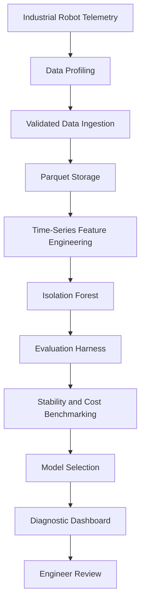
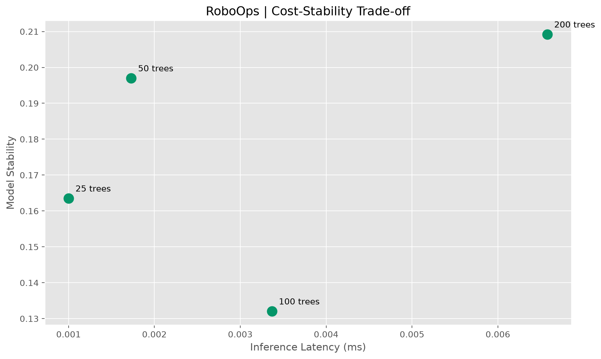
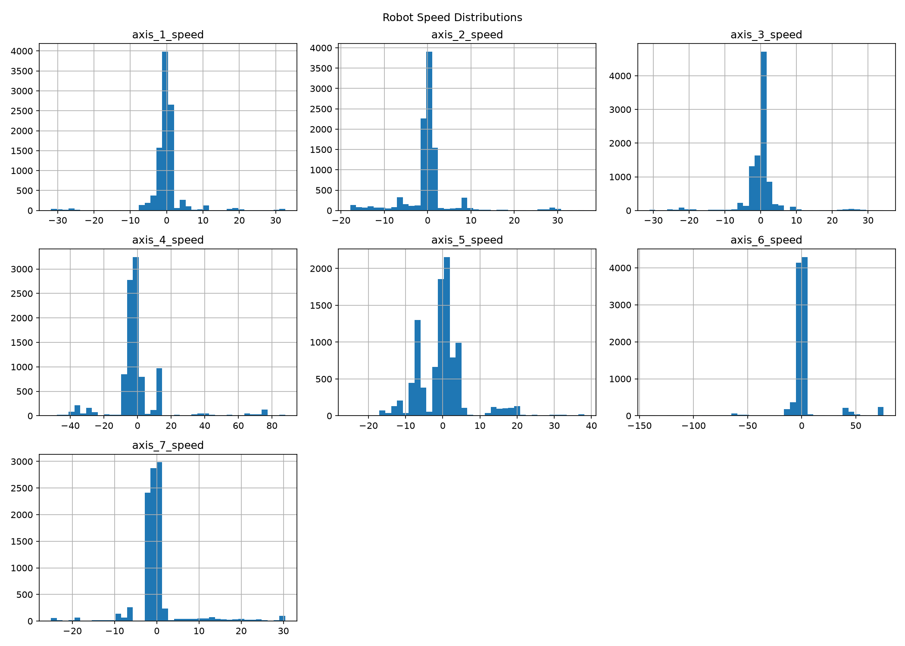
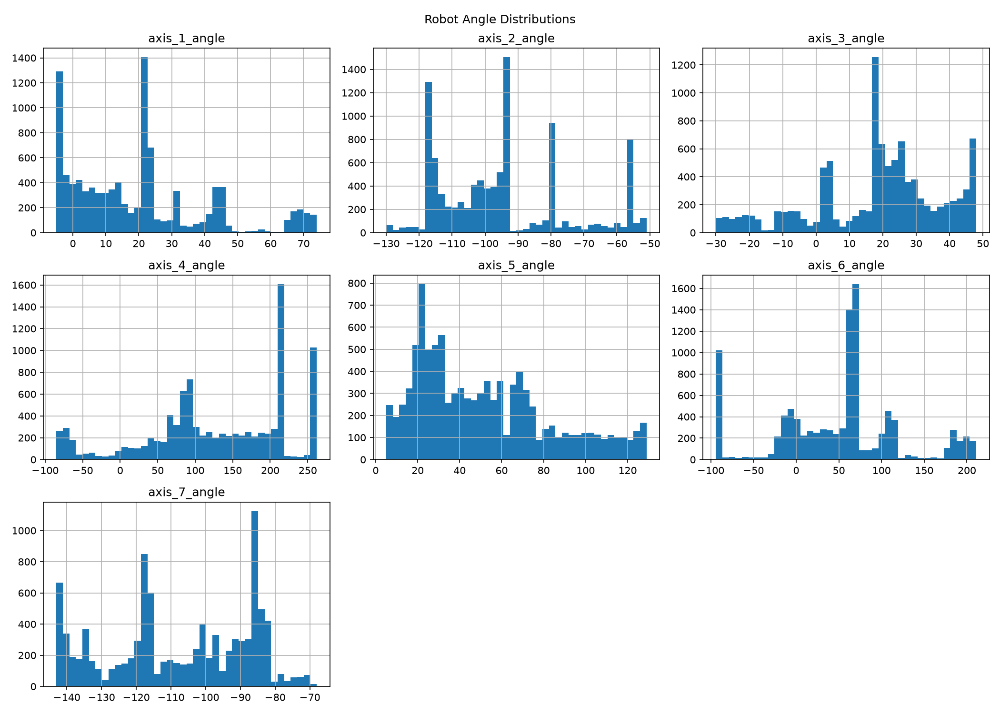
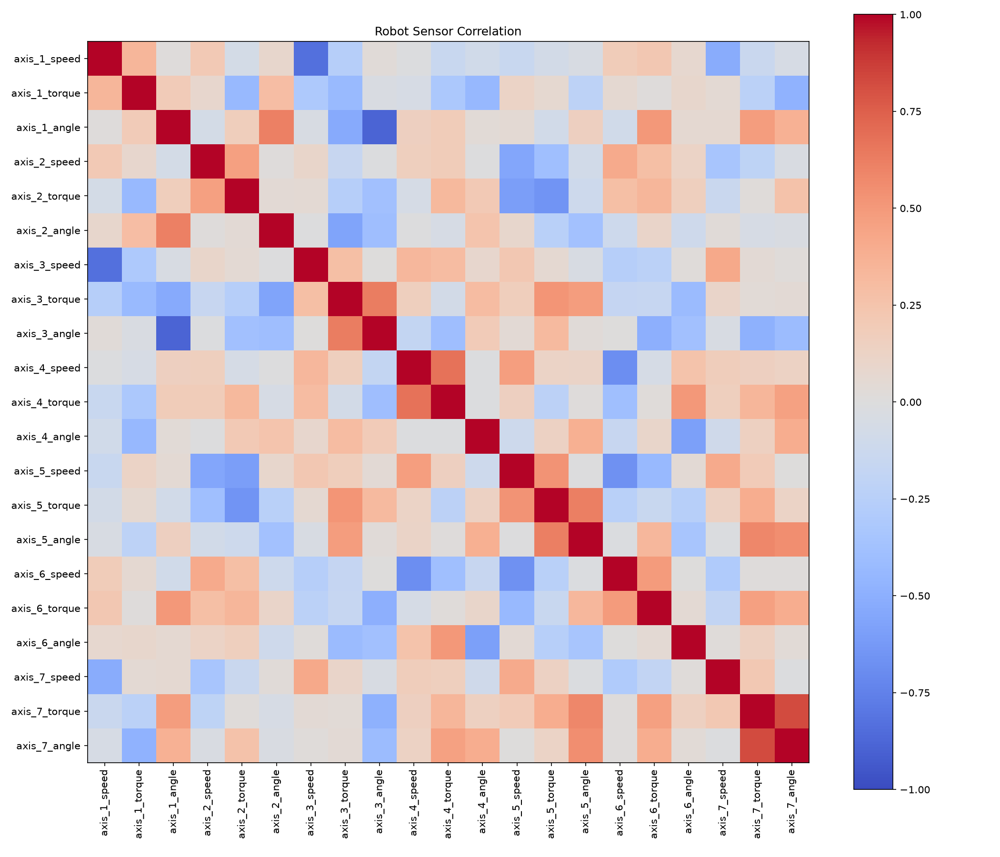

## System Architecture

## Model Reliability and Cost Optimization

Four Isolation Forest configurations are evaluated across
three random seeds to benchmark model stability,
training time, inference latency and model size.

### Model Performance Benchmark

### Cost-Stability Trade-off

Model selection considers computational efficiency
and experimental reproducibility. Detection accuracy
requires independent ground-truth validation.
## Exploratory Data Analysis & Findings

The initial analysis examined 10,000 timestamped telemetry
records across seven robotic joints, representing 70,000
joint observations.

### Initial Data Quality Findings

- Zero JSON parsing errors in the initial sample.
- All seven robotic axes represented.
- 21 raw joint-level sensor measurements.
- Energy measurements unavailable in the initial sample.
- Original dataset size: 2.7 GB.

### Speed Distribution

### Torque Distribution

### Angular Distribution

### Sensor Correlation Analysis

The analysis establishes an initial behavioral baseline
for subsequent time-series anomaly detection research.# RoboOps Intelligence Lab

An Industrial AI research and engineering platform for
robotic condition monitoring using real-world telemetry.

## Objectives

- Industrial robot anomaly detection
- Cost-efficient machine learning
- Predictive maintenance research
- Edge AI benchmarking
- Explainable diagnostics
- Secure AI harness engineering
- Interactive operational intelligence

## Dataset

Real-world seven-axis industrial robot telemetry.

Source: https://doi.org/10.5281/zenodo.17855686

## Project Status

Active development.
