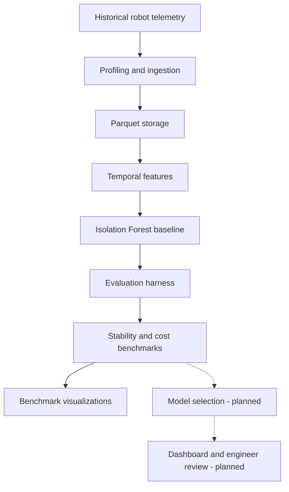
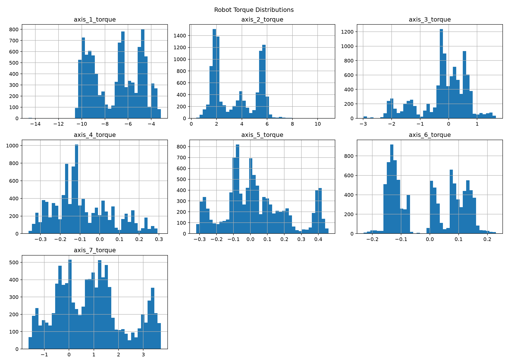
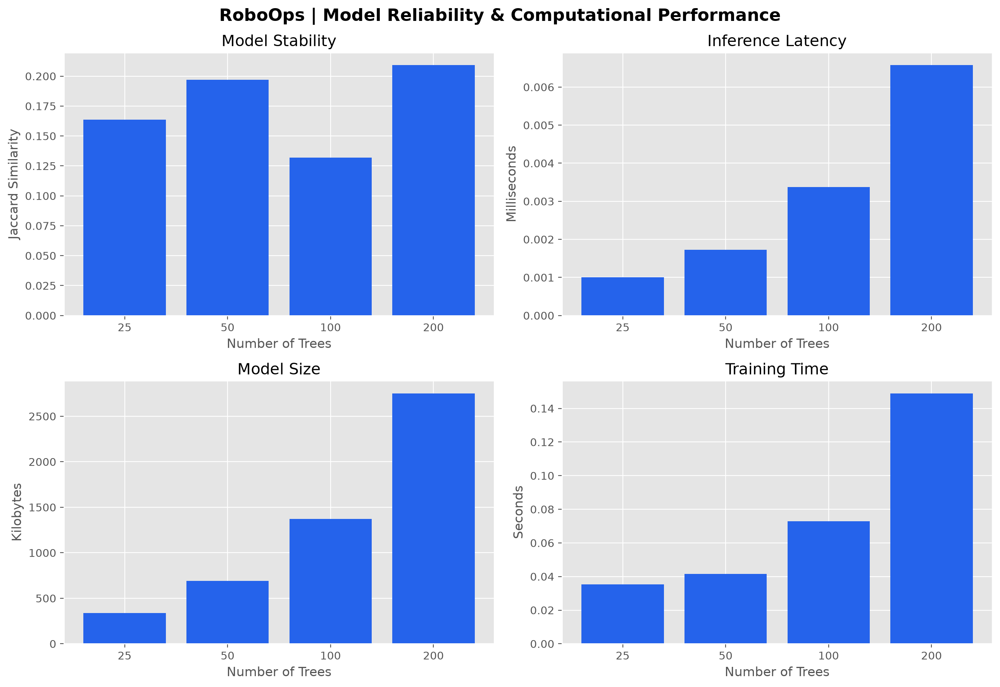

# RoboOps Intelligence Lab

An Industrial AI research and engineering project for condition monitoring of industrial robotic arms using real-world telemetry, time-series machine learning, and resource-aware model evaluation.

**Status:** Active development — offline research prototype.

## Business Problem

Unexpected equipment downtime can disrupt automotive manufacturing and industrial operations. RoboOps explores how historical telemetry can support maintenance engineers in reviewing unusual operating behavior while minimizing unnecessary computational overhead.

The system is advisory only; it does not control physical equipment or replace validated safety systems.

## Dataset

- Source: [Industrial Robot Telemetry Dataset](https://doi.org/10.5281/zenodo.17855686)
- Approximately 2.7 GB extracted locally
- Seven robotic axes with speed, torque and angle measurements
- One training file and 17 held-out test files
- Raw and processed datasets are excluded from Git

## System Architecture



Solid edges show implemented stages; dashed edges indicate planned functionality.

## Exploratory Data Analysis & Findings

The initial analysis examined 10,000 timestamped records across seven robotic joints, representing 70,000 joint observations.

- Zero JSON parsing errors in the initial sample.
- All seven axes represented, with 21 raw joint-level sensor measurements.
- Energy measurements were unavailable in the initial sample; missing energy was not interpreted as zero.

### Speed Distribution


### Torque Distribution



### Angular Distribution


### Sensor Correlation Analysis


## Time-Series Feature Engineering

Five temporal statistics are calculated over the sensor streams: rolling mean, standard deviation, change, RMS and range. The initial rolling window contains 30 observations.

| Metric | Initial experimental result |
| --- | ---: |
| Input records | 10,000 |
| Raw sensor features | 21 |
| Engineered features | 105 |
| Output records | 9,971 |
| Output columns (including metadata) | 128 |
| Missing values in output | 0 |
| DataFrame memory usage | 10.06 MB |

## Model Development

An unsupervised Isolation Forest baseline is trained on the earlier portion of the training sample and evaluated on a later chronological validation segment. Constant features are removed using a selector fitted only on the training portion. A 29-observation gap separates the segments.

Flagged observations represent candidate anomalies, not confirmed equipment failures.

## Model Reliability and Cost Optimization

Four Isolation Forest configurations (25, 50, 100 and 200 trees) are evaluated across three random seeds. The benchmark compares:

- Pairwise Jaccard agreement between flagged observations.
- Training time and average batch inference latency per record.
- Serialized model size as a storage proxy.
- Number of flagged observations.

### Model Performance Benchmark



### Cost-Stability Trade-off


These experiments measure computational efficiency and reproducibility, not ground-truth detection accuracy. The results are specific to the initial sample and local execution environment.

## Reproduce the Experiments

Install the dependencies in a Python virtual environment:

```bash
python -m pip install -r requirements.txt
```

Download the dataset from the source above and extract it under `data/raw/robot.data/`. From the project root, run:

```bash
python src/data_profiler.py
python src/data_ingestion.py
python src/exploratory_analysis.py
python src/feature_engineering.py
python src/anomaly_detector.py
python src/evaluation_harness.py
python src/model_stability.py
python src/visualize_benchmarks.py
```

## Development Roadmap

- [x] Data profiling, ingestion and exploratory analysis
- [x] Time-series feature engineering
- [x] Isolation Forest baseline
- [x] Computational benchmarking and stability experiments
- [x] EDA and benchmark visualizations
- [ ] Validate held-out dataset documentation and ground-truth availability
- [ ] Automated data-quality and model regression checks
- [ ] Resource-aware model selection with independent evaluation
- [ ] Explainable maintenance diagnostics and interactive dashboard
- [ ] Offline edge inference research

## Limitations

This is a research prototype using a limited training sample. Evaluation across independent operating conditions, verified labels, and engineering review are necessary before making operational maintenance decisions.
